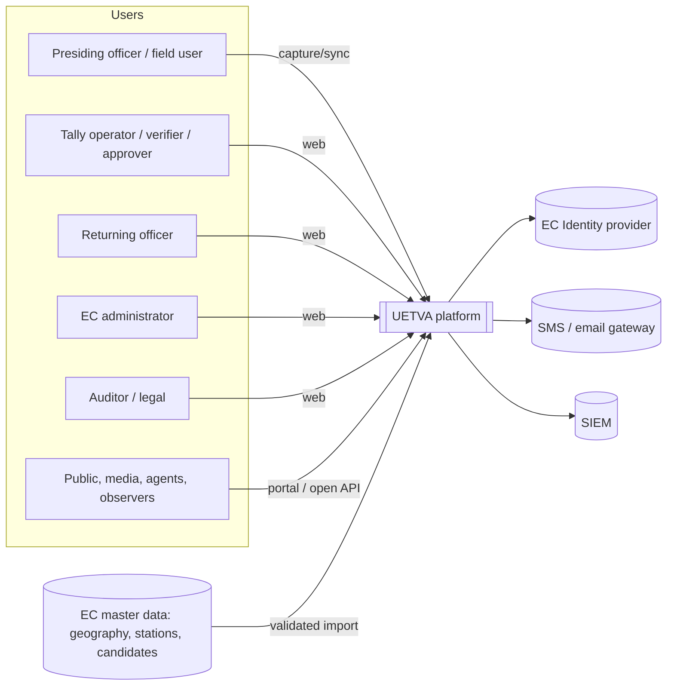
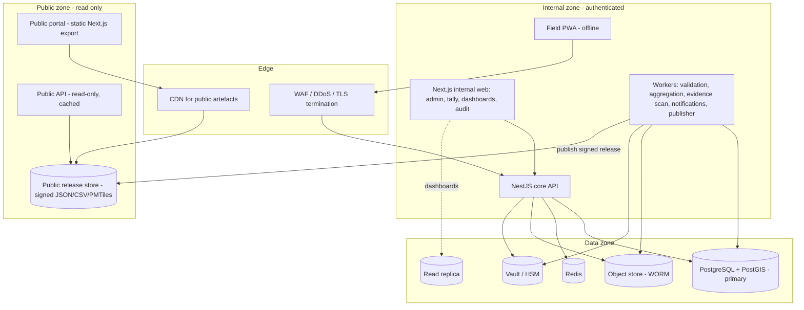
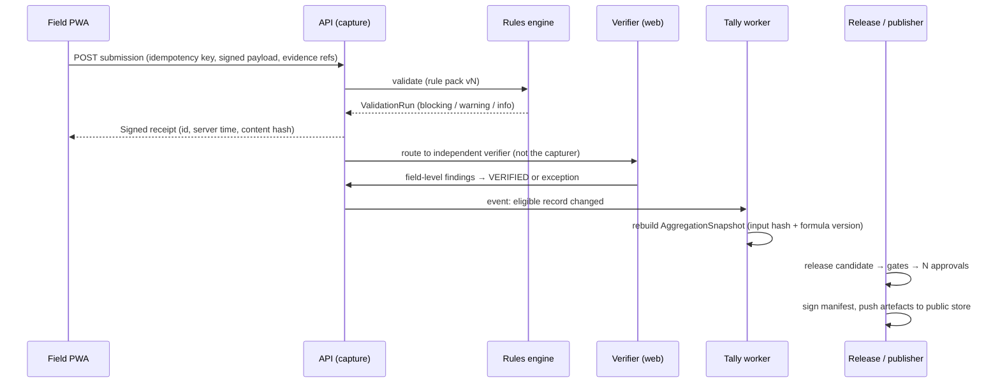

# 01 · Architecture Overview

**Traces:** SRS §15.1, §2.4, NFR-001–015, PUB-005, TAL-009, SEC-012, OPS-001–008

## 1. Architectural drivers

| Driver | Source | Architectural response |
|---|---|---|
| Integrity and traceability over speed | §1.2, TAL-003, EXC-003 | Append-only result store, content hashes, hash-chained audit, reproducible aggregation snapshots |
| Separation of technical and legal state | REL-003/004, TAL-008 | Two independent state machines: *processing state* and *legal status* (see 02) |
| Intermittent field connectivity | §13, R-04 | Offline-first PWA, signed scoped packages, idempotent store-and-forward (see 05) |
| Public traffic spikes must not affect tallying | NFR-004, R-05, UAT-017 | Public read path is physically separate and serves only static/cached release artefacts |
| Every contest can differ | §5, R-01, R-08 | Data-driven rule packs and form templates; no contest-specific code paths |
| Least privilege and segregation of duties | §4.1, IAM-002/005 | Central policy engine (RBAC + attribute scopes), evaluated server-side on every call |

## 2. Technology baseline

| Concern | Choice | Rationale |
|---|---|---|
| Language | TypeScript (strict) end-to-end | Shared types/validation between client, server and rule engine |
| API | NestJS (modular monolith) | Module boundaries match SRS domains; can split later (NFR-010) |
| Database | PostgreSQL 16 + PostGIS | Transactions, row-level security, triggers for append-only, spatial queries |
| Queue / jobs | PostgreSQL-backed queue (pg-boss) first; NATS/Redis Streams if load test requires | Fewer moving parts; transactional outbox |
| Object store | S3-compatible (MinIO on-prem) with Object Lock (WORM) | Evidence immutability, legal hold (CAP-004, EXC-007) |
| Cache / rate limit | Redis | Sessions, rate limiting, hot read models |
| Web | Next.js (React) | Admin console, tally workspace, dashboards, public portal |
| Field client | Next.js PWA + IndexedDB (encrypted) + Service Worker | Offline capture without app-store dependency; Capacitor wrapper optional for MDM devices |
| Maps | MapLibre GL + vector tiles generated from PostGIS (PMTiles) | No licensed basemap dependency; versioned per geography |
| Identity | Keycloak (OIDC) with TOTP/WebAuthn MFA | Self-hostable, supports EC IdP federation (IAM-004) |
| Keys / signing | HashiCorp Vault (Transit) or HSM | Server receipt and release-manifest signing (SEC-003) |
| Observability | OpenTelemetry → Prometheus/Grafana/Loki; SIEM forwarding | NFR-015, OPS-001 |

## 3. C4 — System context

## 4. C4 — Containers

**Key rule:** the public zone has **no network route** to PostgreSQL or the core API. It only reads signed release artefacts that the publisher worker pushes after a release is approved (PUB-001, UAT-012). Unreleased data therefore cannot leak through the public path, and a public traffic surge cannot slow tallying (UAT-017).

## 5. Core API modules (NestJS)

| Module | Responsibility | Requirement IDs |
|---|---|---|
| `config` | Cycles, elections, contests, rule packs, form templates, calendar, activation and freeze | ADM-*, CON-001/006 |
| `geography` | Versioned nodes, voting events, assignments, readiness gaps | GEO-* |
| `participants` | Candidates, parties, options, contest snapshots, delegate eligibility (restricted) | CON-002–008 |
| `iam` | Users, role grants, scopes, SoD checks, devices, step-up auth | IAM-*, SEC-005/009 |
| `capture` | Submissions, versions, idempotent intake, receipts | CAP-*, TRN-002/003 |
| `evidence` | Upload, malware scan, hashing, WORM storage, retrieval | CAP-004/005/010, SEC-008 |
| `rules` | Sandboxed rule/formula engine (declarative expressions, no arbitrary code) | VAL-*, TAL-004 |
| `verification` | Assignment, field-level findings, blind double entry | VER-* |
| `exceptions` | Exception lifecycle, corrections, recounts, legal holds | EXC-* |
| `sync` | Offline packages, sync batches, conflict quarantine | TRN-*, OFF-* |
| `tally` | Aggregation snapshots, lineage, completeness | TAL-* |
| `release` | Release candidates, gates, approvals, manifests, publish, withdraw | REL-*, Appendix C |
| `reporting` | Registers, exports (async, expiring), dashboards' read models | §14, §8 |
| `audit` | Hash-chained audit log, verification endpoint, SIEM export | SEC-006, IAM-007 |
| `notify` | Task and event notifications with privacy-safe templates | NOT-* |

Modules talk to each other only through service interfaces and domain events (transactional outbox). Only `capture`, `verification`, `exceptions` and `release` may write result state, and only through state-machine transitions.

## 6. Request flow (result capture → public release)

## 7. Environments and isolation (SEC-012, TAL-009)

| Environment | Data | Notes |
|---|---|---|
| dev | Synthetic only | Seed generator for Uganda-like geography (fake codes) |
| integration | Synthetic / anonymised | Contract tests and CI |
| uat / training | Simulation cycles | Every record carries `environment` and `is_simulation`; the publisher refuses to publish simulation data to production stores |
| pre-prod | Production-like configuration | Load, failover and DR rehearsals |
| production | Live | Change-controlled, signed artefacts only (OPS-003) |
| DR | Replica | Isolated account/site, tested failover |

Each environment has separate keys, so a receipt or manifest signed in UAT fails verification in production.

## 8. Hosting and resilience

- **Data residency:** host in Uganda (EC data centre or NITA-U government cloud) unless the EC decides otherwise (decision D-09 in 06). The design avoids hyperscaler-only services.
- **Primary/DR:** two sites. PostgreSQL streaming replication (synchronous within the site, asynchronous to DR) plus WAL archiving to WORM storage meets RPO ≤5 min. Object store replicates with version and lock retention.
- **Public path:** static artefacts can also be mirrored to an external CDN. Static output tolerates the 50,000-concurrent-session target cheaply (NFR-005).
- **Backups:** nightly base backup plus continuous WAL, an offline copy, and a monthly restore test that reconciles row counts and hashes (OPS-004, UAT-015).
- **Read-only archive mode:** after a cycle closes, its schema is frozen (revoked write grants) and stays queryable (OPS-008).

| Data | RPO | RTO | Mechanism |
|---|---|---|---|
| Results and audit DB | ≤5 min | ≤60 min | Sync replica + WAL archive, scripted promotion |
| Evidence | ≤15 min | ≤4 h | Bucket replication, hash reconciliation job |
| Public portal | ≤15 min | ≤2 h | Re-publish from the latest signed manifest |
| Identity/config/keys | ≤5 min | ≤2 h | Keycloak DB replica, Vault DR replication, dual-control unseal |

## 9. Cross-cutting conventions

- All timestamps stored as UTC `timestamptz` and displayed in Africa/Kampala. Device, source-form and server times are kept in separate fields (NFR-012).
- Vote counts are `bigint` with `CHECK (value >= 0)`. There is no floating point in counts. Percentages are computed at display time from integers (VAL-008).
- Every request carries a correlation ID, propagated to audit, logs and traces.
- Logs and metrics never contain vote values, signatures or personal data (NFR-015, NOT-003).
