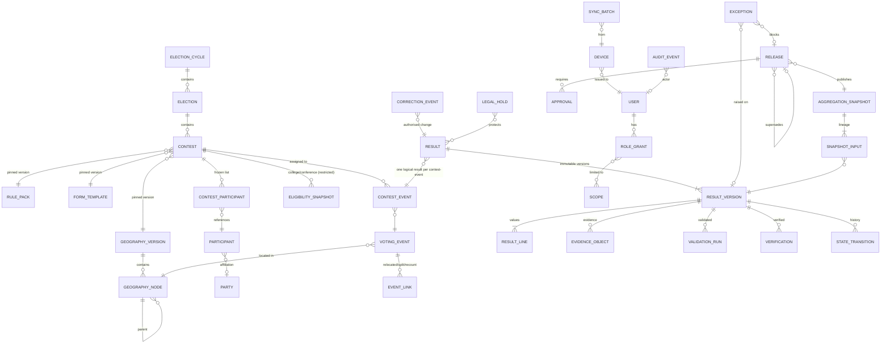
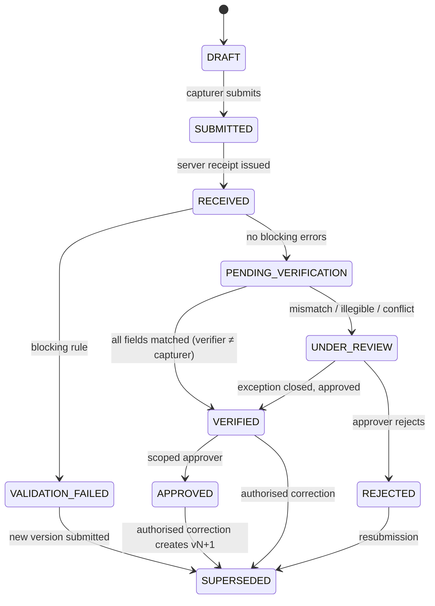
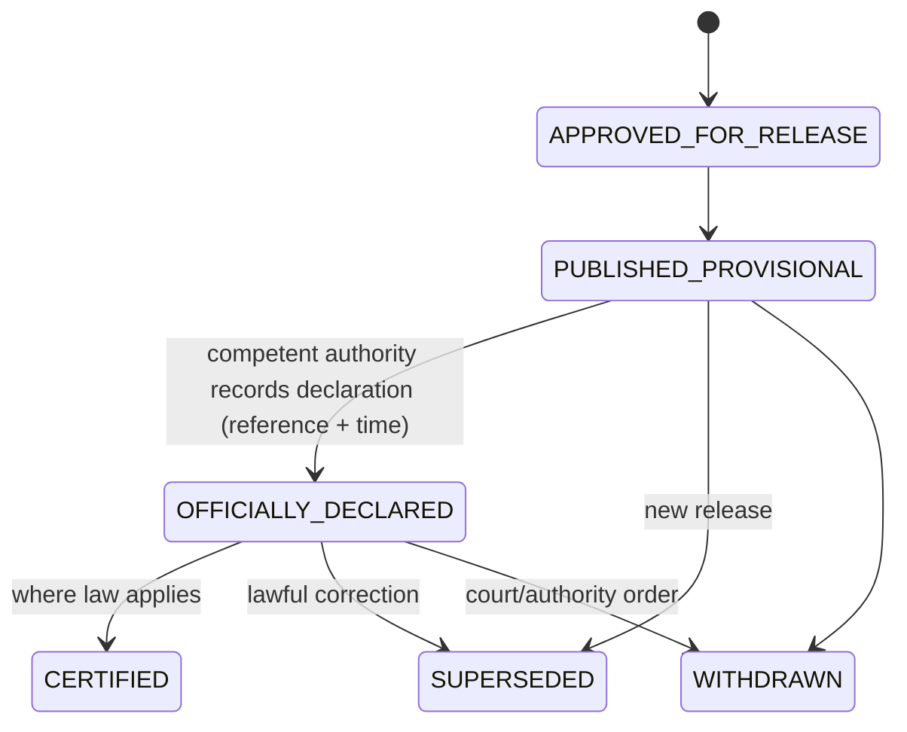

# 02 · Domain and Data Model

**Traces:** SRS §9, §9.1, §5.2, Appendix A, Appendix B, CAP-*, VAL-*, EXC-*, TAL-*, REL-*

## 1. Entity-relationship diagram



## 2. Entity notes (beyond SRS §9 minimums)

| Entity | Key design points |
|---|---|
| `election_cycle`, `election`, `contest` | `config_status` ∈ draft → reviewed → approved → active → superseded → archived (§5.2). Activation is blocked by an `activation_checklist` view listing missing items (ADM-004). |
| `rule_pack`, `form_template` | `(code, version)` unique. Immutable once `approved` (enforced by trigger). Carries `legal_citation`, `effective_from`, `test_fixtures` (JSON) and approver IDs. A rule pack holds declarative validations and formulas (see §5). |
| `geography_version` / `geography_node` | Nodes belong to one version. `node_type` comes from a configurable catalogue (region, district, city, county, constituency, subcounty, municipality, division, parish, ward, village). Valid parent→child type pairs are defined per contest hierarchy (GEO-001/002). Geometry is optional `geometry(MultiPolygon, 4326)`. |
| `voting_event` | `event_type` ∈ POLL_STATION, ELECTORAL_COLLEGE, CONFERENCE, COUNCIL_ASSEMBLY, REFERENDUM_STATION, OTHER. Relocation, split, merge and recount create `event_link` rows; nothing is deleted (GEO-006, EXC-006). |
| `participant` | `kind` ∈ CANDIDATE, INDEPENDENT_CANDIDATE, PARTY, OPTION (CON-002). `contest_participant` holds ballot order, ballot label and nomination status. It is frozen at contest activation (CON-006). |
| `eligibility_snapshot` | Delegate rosters for colleges and conferences. Stored in a separate `restricted` schema with no grant to reporting or public roles (CON-007/008). |
| `result` | Logical slot, unique on `(contest_id, contest_event_id)`. Holds a pointer `current_version_id`. |
| `result_version` | Immutable row containing `version_no`, `form_template_version`, `rule_pack_version`, `form_serial`, captured_by, device, `device_time`, `server_received_at`, `payload_hash`, `prev_version_id`, `reason` and `processing_state`. |
| `result_line` | `(result_version_id, line_code)` where line_code is either `participant:<id>` or a form field code (e.g. `BALLOTS_ISSUED`). Value is `bigint ≥ 0`, with `null` meaning *not provided* (never coerced to 0). |
| `evidence_object` | `sha256`, `media_type`, `bytes`, `page_no`, `object_key` (WORM bucket), `scan_status` and `quality_flag`. |
| `aggregation_snapshot` | Contest, level, geography node, `input_set_hash` (hash of sorted input version hashes), `formula_version`, totals JSON, `inclusion_policy` and `completeness` (numerator/denominator). |
| `release` | Scope, snapshot IDs, `legal_status_label`, manifest JSON, `manifest_sha256`, `signature`, `published_at` and `supersedes_release_id`. |
| `audit_event` | Append-only and hash-chained: `hash = sha256(prev_hash ‖ canonical_json(event))`. |

## 3. Two state machines — never conflated (REL-003/004)

### 3.1 Processing state (per `result_version`)



Aggregation for **verified totals** includes only APPROVED versions (or VERIFIED, if the contest's rule pack sets `inclusion_policy = VERIFIED`). Internal views show every other state segmented and never merged (TAL-001, TAL-006, §8.6).

### 3.2 Legal status (per `release`, set only by authorised humans)



The system has no automatic transition into OFFICIALLY_DECLARED or CERTIFIED. Each requires a recorded authority reference, the declaring officer's identity and evidence of the official declaration (TAL-008). The status vocabulary itself is configuration (open decision D-03).

Every transition in both machines writes a `state_transition` row (from, to, actor, reason, approval IDs and time) plus an audit event.

## 4. Immutability and append-only enforcement (EXC-003/005, SEC-006)

| Mechanism | Applies to |
|---|---|
| `BEFORE UPDATE OR DELETE` trigger raising an exception | `result_version`, `result_line`, `evidence_object`, `validation_run`, `verification`, `state_transition`, `audit_event`, `aggregation_snapshot`, `release` (except the guarded status column), approved `rule_pack`/`form_template` |
| Application DB role has `INSERT, SELECT` only on these tables | Defence in depth: privilege removal backs up the trigger |
| Migration role separate, used only by signed deployments | OPS-003 |
| Hash chain on `audit_event`, with a daily anchor hash exported to WORM storage and SIEM | Tamper evidence. A `GET /audit/verify` job recomputes the chain |
| Evidence bucket with Object Lock (compliance mode) | Original bytes cannot be overwritten or deleted during retention or legal hold |
| `legal_hold` checked by the disposal job and by the bucket's lock API | EXC-007, UAT-014 |

## 5. Rule packs: declarative, testable, versioned (VAL-001–009, TAL-004)

Rules are JSON documents evaluated by a sandboxed expression engine (JSONLogic-style AST, integer arithmetic only). They contain no arbitrary code.

```json
{
  "code": "PRES_PS_2026", "version": 3,
  "legal_citation": "Presidential Elections Act Cap.179 s.__ (to confirm)",
  "validations": [
    {"id": "V01", "severity": "BLOCKING",
     "msg": "Sum of candidate votes must equal total valid votes",
     "expr": {"==": [{"sum": {"var": "participants"}}, {"var": "VALID_VOTES"}]}},
    {"id": "V02", "severity": "BLOCKING",
     "msg": "Valid + invalid must equal ballots found in box",
     "expr": {"==": [{"+": [{"var": "VALID_VOTES"}, {"var": "INVALID_VOTES"}]}, {"var": "BALLOTS_IN_BOX"}]}},
    {"id": "V10", "severity": "WARNING",
     "msg": "Ballots in box exceed registered voters",
     "expr": {">": [{"var": "BALLOTS_IN_BOX"}, {"var": "REGISTERED_VOTERS"}]}}
  ],
  "aggregation": {"inclusion_policy": "APPROVED", "levels": ["parish","subcounty","constituency","district","national"]},
  "outcome_formula": null,
  "test_fixtures": [{"input": {}, "expect": {"V01": "pass"}}]
}
```

- The **fields and arithmetic shown above are placeholders** until the EC supplies the official forms (D-05).
- A rule pack cannot be approved unless all of its `test_fixtures` pass in CI and in the admin preview (§5.2).
- `outcome_formula` (thresholds, run-off triggers) is optional, and its output is labelled *calculation*, never *winner* (TAL-008).

## 6. Hashing and canonicalisation

- **Canonical JSON:** RFC 8785 (JCS), applied on client and server.
- `payload_hash = sha256(JCS(result payload without evidence bytes) ‖ sorted evidence sha256s)`.
- `input_set_hash` for a snapshot is `sha256` of the sorted list of `(result_version_id, payload_hash)`. Re-running with the same inputs and formula version must reproduce byte-identical totals (TAL-007, UAT-013).
- `manifest_sha256` covers scope, snapshot IDs, totals, rule versions, approvers and timestamps. The manifest is signed with the environment's release key (REL-006).

## 7. Physical layout (initial)

- Schemas: `config`, `geo`, `results`, `evidence`, `workflow`, `tally`, `release`, `iam`, `audit`, and `restricted` (delegate data).
- Partition `result_line` and `audit_event` by `cycle_id`.
- Row-level security on `results.*` and `workflow.*` keyed on the session's scope claims. This is a backstop to the API policy engine (IAM-002).
- Reporting and dashboards read from a replica through views that already exclude restricted columns.
