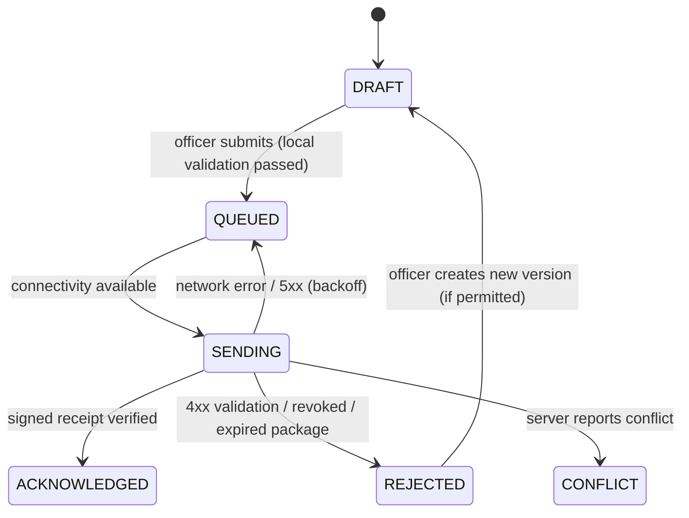
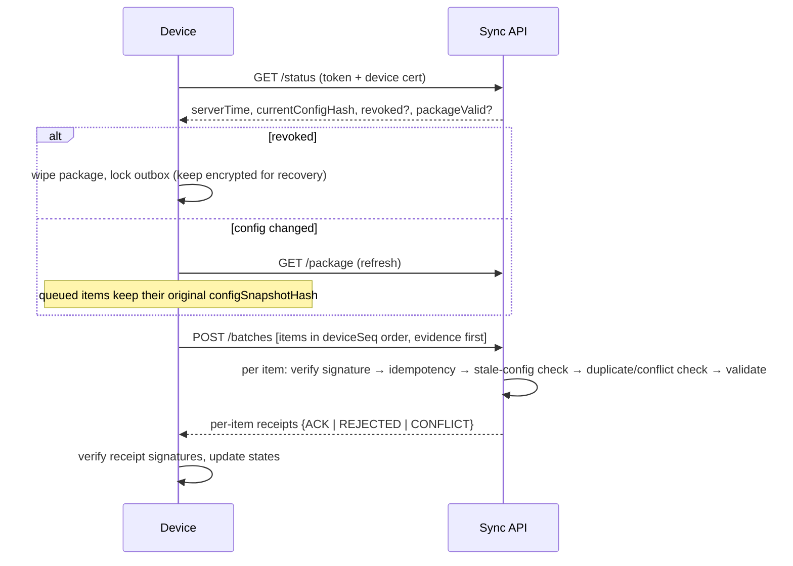

# 05 · Offline Operation and Synchronisation Protocol

**Traces:** §13, §13.1, OFF-001–010, TRN-001–008, UAT-007/008/016

## 1. Field client storage

| Store (IndexedDB) | Contents | Protection |
|---|---|---|
| `package` | Signed offline package: user scope, events, contests, frozen participants, form templates, rule packs, expiry | Verified on load; refuses if signature invalid or expired (OFF-002) |
| `outbox` | Submissions with `clientTxnId`, `deviceSeq`, state | AES-GCM with key derived from device key + user PIN (OFF-003) |
| `evidence` | Image blobs + sha256 | Same encryption; images are never written to the camera roll |
| `receipts` | Signed server receipts | Kept for the officer's own proof |

The same rule engine (shared TypeScript package) runs on the device, so blocking errors are caught before submission. The server re-validates everything and its result is authoritative.

## 2. Offline package

- Built per user and device on request, containing **only** the assigned scope (OFF-001).
- Signed with the package key and encrypted to the device public key.
- Carries `configSnapshotHash` and `expiresAt` (default 72 h; set per contest).
- Re-fetched automatically when online if `GET /sync/v1/status` reports a newer config version.

## 3. Outbox item states (OFF-005)

The UI shows counts per state, the oldest pending item and the last successful sync time. These are also reported to the server for the operations dashboard (OFF-010).

## 4. Sync sequence (OFF-006)

- **Evidence first:** evidence is uploaded with resumable chunks and finalised by hash before the submission referencing it. This prevents submissions that point to missing evidence.
- **Ordering:** the server records `deviceSeq` gaps as warnings, which may indicate a missing or tampered item.
- **Backoff:** exponential with jitter (1 s → 5 min). The server can send `Retry-After` and priority hints, and result submissions outrank evidence re-uploads (TRN-008).
- **Every attempt is logged** server-side with outcome and timing (TRN-006).

## 5. Server-side decision table per item

| Check | Outcome |
|---|---|
| Device revoked or signature invalid | `REJECTED`, payload quarantined, security alert (TRN-005, OFF-008) |
| Same `clientTxnId` and same hash seen before | Return original receipt (no duplicate) |
| Same `clientTxnId`, different hash | `CONFLICT`, quarantine, security alert |
| Package `configSnapshotHash` ≠ current **and** the contest's form/participants changed | `RECEIVED` with processing state `UNDER_REVIEW` and an exception of type `STALE_CONFIG` (UAT-008). It is never silently re-mapped |
| Contest-event already has a current version from another submission | `CONFLICT` → both versions frozen from aggregation, exception `SYNC_CONFLICT` |
| Same `form_serial` already used on a different event | `RECEIVED` + exception `DUPLICATE_SERIAL` |
| Otherwise | `RECEIVED` → validation → normal workflow |

## 6. Conflict resolution (§13.1)

1. Detect the conflict on `(contest_event, submission id, version, hash)`.
2. Freeze all conflicting versions from aggregation. They are shown as *disputed* internally.
3. Create an exception linking every payload, receipt and transmission record.
4. Assign an independent reviewer plus an authorised decision-maker (SoD-1).
5. Compare the evidence images and history side by side.
6. Either select one version as current or create a corrected version (with dual approval).
7. Preserve all payloads and the decision record.
8. Recompute affected snapshots and flag any published release that included them, then route it for correction or withdrawal.

**Last-write-wins is never applied to result data** (TRN-007, OFF-007).

## 7. Lost device and recovery

- An admin revokes the device, after which the server rejects all calls and the next `/status` call wipes the package (OFF-008).
- An unsent outbox on a recovered device can be exported as an encrypted recovery bundle only through an audited support procedure with a two-person unlock (OFF-009).
- Paper forms remain the source of truth, so a lost device's results can be captured at the tally centre from the official form and its evidence.
